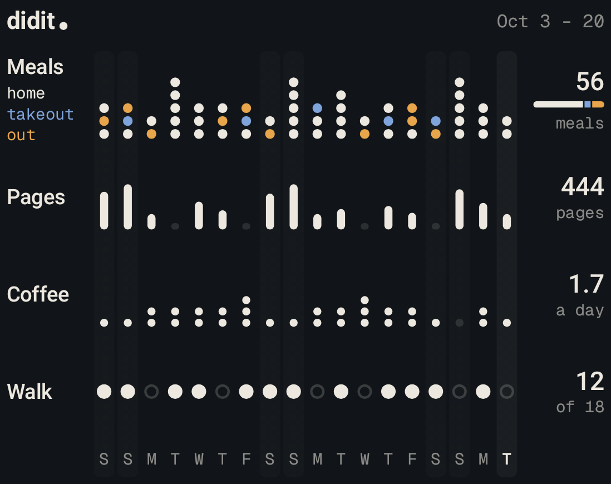
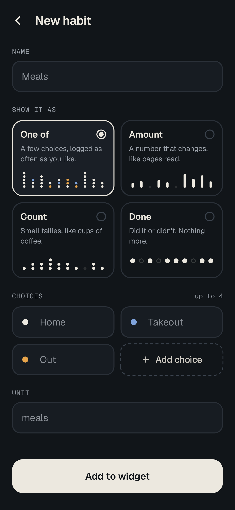
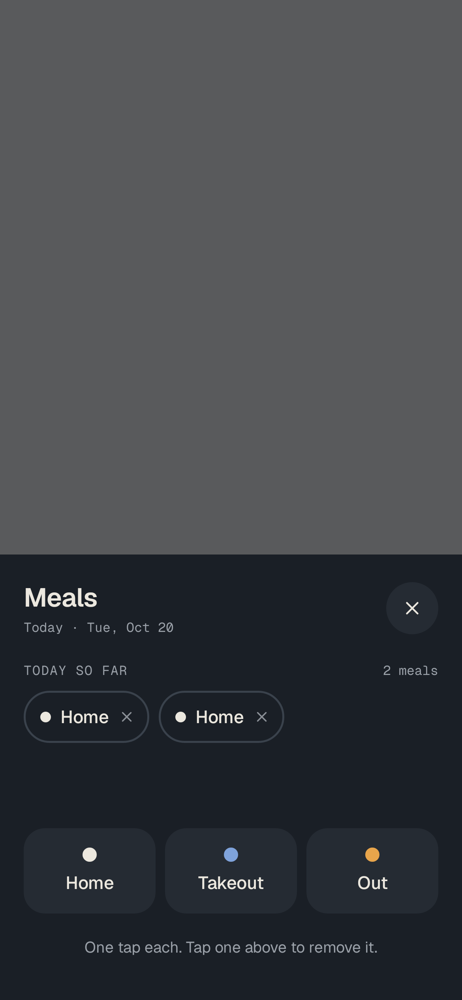
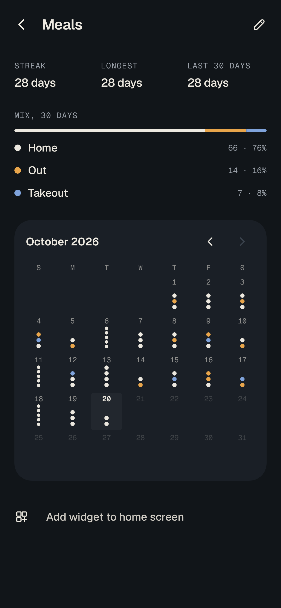

# didit

A quiet habit tracker that lives on your home screen. It's made for [Niagara Launcher](https://niagaralauncher.app),
and works on any launcher.

Didit isn't about hitting goals. It shows you *what your days look like*: whether you ate in or out, how many pages
you read, how much coffee you drank, whether you walked. Every day becomes a mark, and the patterns show up on their own.

<p>
  
</p>

## Four ways to see a habit

| Kind | For | Drawn as |
| --- | --- | --- |
| **One of** | A few outcomes, logged as often as they happen: *home / takeout / out* | One coloured dot per pick, stacked |
| **Amount** | A number that changes: *pages read* | A bar, scaled to your ordinary days |
| **Count** | Small tallies: *cups of coffee* | A stack of pips |
| **Done** | Did it or didn't: *walk* | A filled dot, or an empty ring |

<p>
  
  
  
</p>

## The widget

- **Every habit** (the default): one row per habit over the last two weeks, with weekday letters, and today and
  weekends banded. It shows as many days and rows as the widget has room for.
- **One habit**: a four-week strip when the widget is wide, a weekday-by-week calendar when it's square.
- Tap a row to log today. *Done* habits toggle in one tap; the rest open a small log sheet.
- **Card** or **clear** background. Clear sits on the wallpaper like the rest of Niagara. The ink follows the system
  theme, or can be pinned light or dark to suit your wallpaper.

Long-press the widget and choose *Reconfigure* (Android 12+) to change what it shows.

## Building

Requires JDK 21 and the Android SDK (compile SDK 37).

```sh
./gradlew assembleDebug          # build
./gradlew spotlessCheck lint     # format and lint (warnings are errors)
./gradlew :core:domain:test :core:data:testDebugUnitTest :app:testDebugUnitTest
./gradlew recordRoborazziDebug   # re-record screenshots after a visual change
./gradlew verifyRoborazziDebug   # compare against the recorded screenshots
./gradlew :app:bundleRelease     # signed AAB for Play (needs keystore.properties)
```

## Play

Package `dev.platte.didit`. Release signing needs `keystore.properties` and `upload-keystore.jks`
in the project root. Both are gitignored, and without them the release build is unsigned. Bump
`versionCode` in `app/build.gradle.kts` for every upload.

## How it's put together

```
core/domain   Pure Kotlin. Models, validation, stats, and what each day looks like (glyphs). No Android.
core/data     Room. The only HabitRepository implementation.
app           Compose UI, the Glance widget, Hilt wiring.
```

- **One painter, two surfaces.** `GlyphPainter` draws onto a plain Android `Canvas`. The app hands it Compose's
  native canvas; the widget hands it a bitmap. The two can't drift apart.
- **Dark mode without redrawing.** The widget renders each drawing in two layers: an ink mask, which the launcher
  tints with a day/night colour, and a fixed-colour accent layer. Every quiet shade in the design is ink at reduced
  strength, which is what makes this possible.
- **Domain first.** What a day looks like (`Glyph`), how a window sums up (`WindowSummary`), streaks and mixes
  (`HabitStats`) are all plain functions in `core/domain`, tested without an emulator.
- **History is never rewritten.** Removing a choice archives it, so the days it was logged on keep their colour.
- **Screenshot tests** (Roborazzi + Robolectric) render every screen and widget layout from the design's own sample
  data. They're the images in this README.

Libraries: Kotlin 2.4, Compose (Material 3), Navigation 3, Glance 1.2, Room 2.8, Hilt, WorkManager; JUnit, Truth,
Turbine, Robolectric, Roborazzi; Spotless with ktlint and the Compose rules.

## Licences

Geist and Geist Mono are licensed under the SIL Open Font License; see [`licenses/Geist-OFL.txt`](licenses/Geist-OFL.txt).
